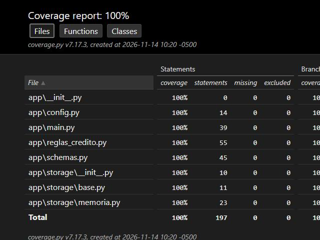
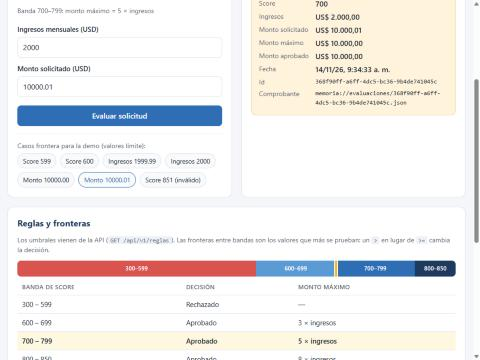
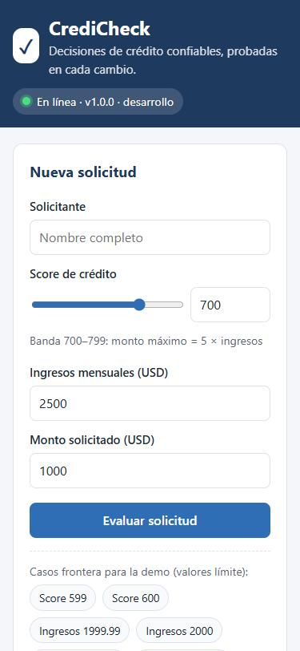
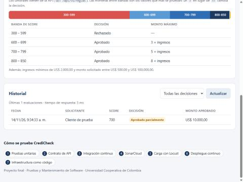

# Backend, frontend y notificaciones (Juan Camilo)

Rama: `feature/backend-frontend` · Tareas JC-0 a JC-11 de la propuesta ·
Semanas que demuestra: S1, S2, S3, S4 y las notificaciones de S9.

## 1. Reglas de negocio (`backend/app/reglas_credito.py`)

| Paso | Regla | Resultado |
|---|---|---|
| 1 | Tipos: score `int` (no `bool`); ingresos y monto numéricos (no `bool`) | `TypeError` |
| 1 | Dominios: 300 ≤ score ≤ 850 · ingresos ≥ 0 · 500 ≤ monto ≤ 100 000 | `ValueError` |
| 2 | `score < 600` | `RECHAZADO` · `SCORE_INSUFICIENTE` |
| 3 | `ingresos < 2000` | `RECHAZADO` · `INGRESOS_INSUFICIENTES` |
| 4 | `monto_maximo = ingresos × multiplicador` (600–699 ×3 · 700–799 ×5 · 800–850 ×8) | — |
| 5 | `monto ≤ monto_maximo` | `APROBADO` · `CUMPLE_REQUISITOS` |
| 5 | `monto > monto_maximo` | `APROBADO_PARCIAL` · `MONTO_AJUSTADO` (se aprueba el máximo) |

Los umbrales viven solo en las constantes del módulo; `GET /api/v1/reglas` los expone y el frontend los
dibuja, así que no hay números «quemados» en la interfaz.

## 2. Pruebas unitarias

```bash
cd backend
python -m pip install -r requirements.txt
python -m pytest
```

| Archivo | Qué prueba | Técnica |
|---|---|---|
| `test_reglas_credito.py` | Matriz BVA (filas F02–F17 de la sección 4.5 + on points de monto 100 000 e ingresos 0), particiones, multiplicadores, redondeo | BVA, EP, parametrize, AAA |
| `test_validaciones.py` | Filas F01, F10, F11, F16, F18, NaN/infinito y 10 tipos inválidos | Pruebas negativas con `pytest.raises` |
| `test_endpoints.py` | Contrato de la API: 201, 400, 404, 422, orden y límite del historial, `/health` sano y con fallo simulado, fábrica de almacenamiento | TestClient + repositorio en memoria |
| `test_memoria.py` | Adaptador en memoria: comprobante, orden, duplicados, copias | AAA |

Resultado: **91 pruebas en verde, cobertura de líneas y ramas del 100 %** (Quality Gate: 80 %).
Salida completa en [evidencias/juan-camilo/cobertura.txt](evidencias/juan-camilo/cobertura.txt).
El reporte visual queda en `backend/htmlcov/index.html` al ejecutar las pruebas:



### Cadena error → defecto → fallo (demo de la falla 1)

Si alguien entiende «el score debe ser *mayor* a 600» (error) y escribe `if score <= 600` en lugar de
`if score < 600` (defecto), una persona con score exactamente 600 sería rechazada (fallo). Al inyectar ese
cambio, **4 pruebas fallan de inmediato**, entre ellas la frontera BVA `F04_score_600_on_point_aprobacion`.
Para la sustentación se prepara en una rama `demo/` (nunca se hace merge).

### Demo del Quality Gate (falla 2)

Borrar las pruebas de `APROBADO_PARCIAL` deja ramas sin cubrir: `pytest` falla con
«Required test coverage of 80% not reached» y `htmlcov` muestra en rojo las líneas sin probar.

## 3. API (`backend/app/main.py`, `schemas.py`)

| Método y ruta | Respuestas |
|---|---|
| `GET /health` | 200 sano · 500 si `FORZAR_FALLO_SALUD=true` |
| `GET /api/v1/reglas` | 200 |
| `POST /api/v1/evaluaciones` | 201 · 400 (valor fuera de dominio) · 422 (tipo inválido, campo faltante o extra) |
| `GET /api/v1/evaluaciones?limite=20` | 200 (más recientes primero) · 422 si `limite` no está entre 1 y 100 |
| `GET /api/v1/evaluaciones/{id}` | 200 · 404 |

Documentación interactiva en http://localhost:8000/docs.

**Acuerdo para el adaptador S3/SQS (Saray):** `guardar(evaluacion)` debe persistir la evaluación **incluyendo
el campo `comprobante`** (la misma referencia que retorna), porque `GET /api/v1/evaluaciones/{id}` y el historial
devuelven exactamente lo que el repositorio tiene guardado. El adaptador en memoria ya lo hace así.

## 4. Docker del backend

```bash
docker build -t credicheck-api:v1 ./backend
docker run --rm -p 8000:8000 credicheck-api:v1
```

Imagen `python:3.11-slim` de 267 MB, dependencias en una capa aparte (caché), usuario sin privilegios
(`appuser`) y sin pruebas dentro de la imagen (`.dockerignore`). Evidencia en
[evidencias/juan-camilo/docker-imagen.txt](evidencias/juan-camilo/docker-imagen.txt).

## 5. Frontend (`frontend/`)

HTML, CSS y JavaScript sin frameworks, servido por nginx en http://localhost:8081 (proxy de `/api` y `/health`
hacia la API, sin problemas de CORS).

- **Indicador de estado** (verde/rojo, versión y entorno) que se refresca cada 15 s.
- **Nueva solicitud** con deslizador de score y **botones de casos frontera** (599/600, 1999.99/2000,
  10000.00/10000.01 y 851 inválido) para la demo.
- **Resultado** con color por decisión, motivo en lenguaje natural, montos, id y comprobante.
- **Reglas y fronteras**: barra de bandas generada desde la API con marcador del score actual.
- **Historial** con filtro por decisión, detalle al hacer clic y tiempo de respuesta medido.
- Los datos del usuario se pintan con `textContent` (nunca `innerHTML`) para evitar XSS.

| Escritorio | Celular |
|---|---|
|  |  |



> Mientras el adaptador S3/SQS de Saray no esté listo, el `docker-compose.yml` (que usa `STORAGE_BACKEND=s3`)
> solo responde `/health` y `/api/v1/reglas`. Para probar todo en local se puede usar un override con
> `STORAGE_BACKEND=memoria` sin subirlo al repositorio.

## 6. Notificaciones de Telegram (`deploy/notificador.py`)

Contrato para `deploy.py` y `consumidor_eventos.py` (Saray):

```python
notificar(mensaje: str) -> bool
mensaje_despliegue_exitoso(version: str, commit: str, lead_time_s: float) -> str
mensaje_rollback(version: str, motivo: str, version_estable: str) -> str
mensaje_servidor_inaccesible(url: str, error: str) -> str
mensaje_evento_credito(evaluacion: dict) -> str
```

- El token y el chat id se leen **solo** de `TELEGRAM_BOT_TOKEN` y `TELEGRAM_CHAT_ID` (GitHub Secrets).
- Si faltan, imprime `[TELEGRAM DESACTIVADO]` y retorna `False`; nunca lanza excepciones ni imprime el token.
- Bot: **@Pm_finalBot**. Secretos `TELEGRAM_BOT_TOKEN` y `TELEGRAM_CHAT_ID` cargados en GitHub Actions.
  Prueba real del 14-11-2026: 3/3 mensajes enviados (éxito, rollback y servidor inaccesible).
- Pruebas sin red real (12 casos):

```bash
python -m pytest deploy/test_notificador.py -p no:cacheprovider
```

- Prueba manual con el bot real (envía los tres tipos de mensaje):

```powershell
$env:TELEGRAM_BOT_TOKEN="<token de BotFather>"; $env:TELEGRAM_CHAT_ID="<id del grupo>"
python deploy/notificador.py
```
